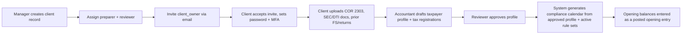
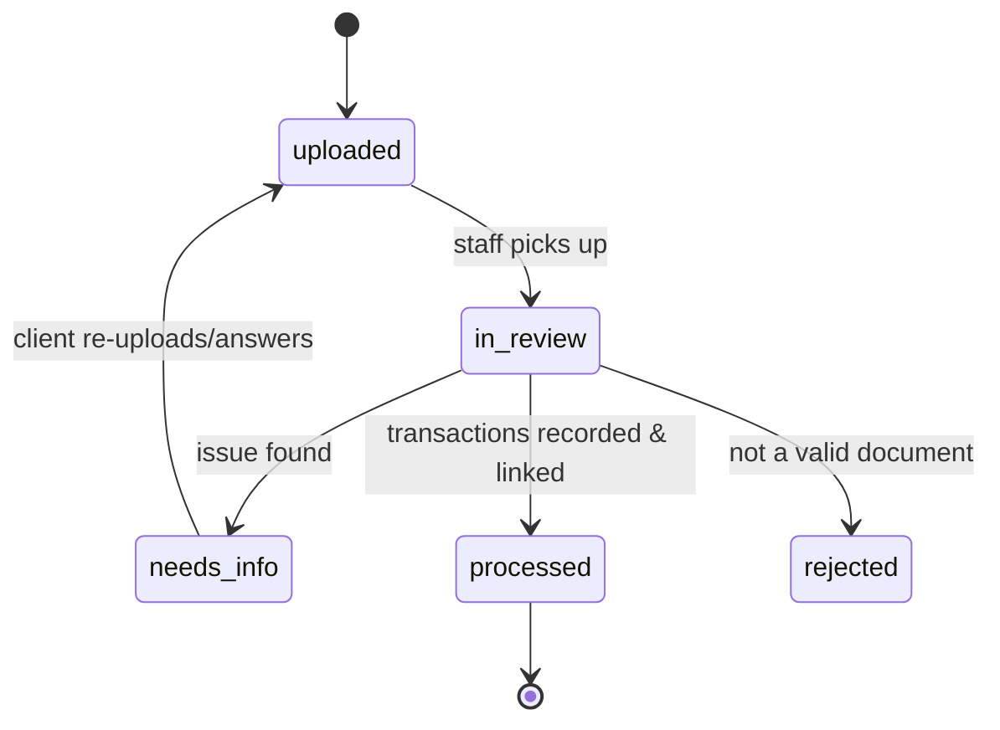
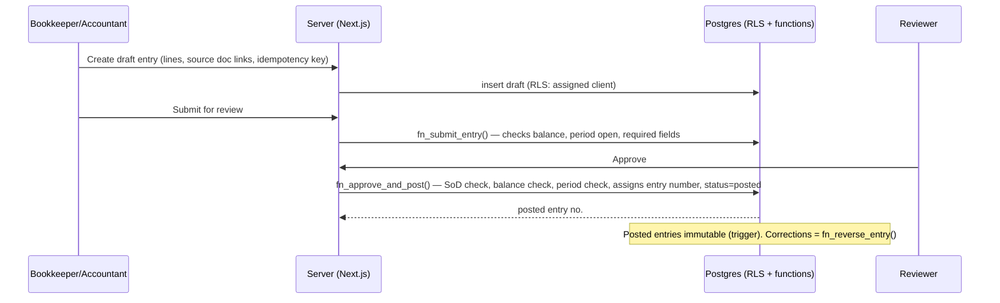
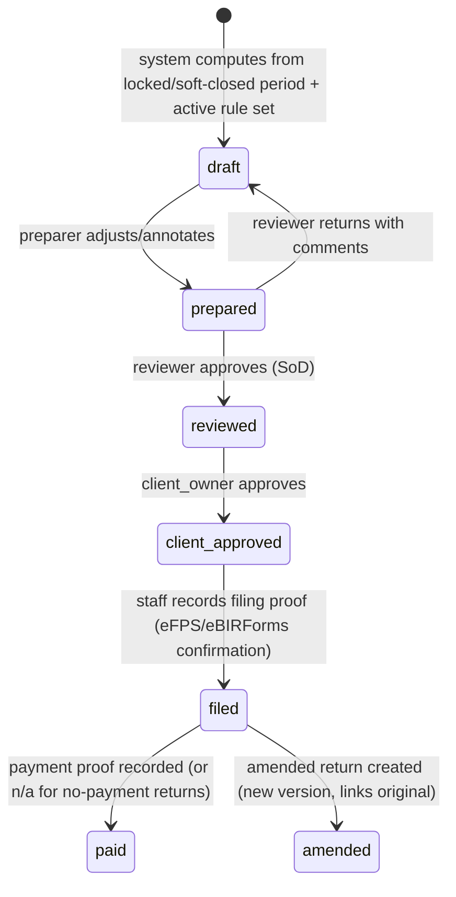
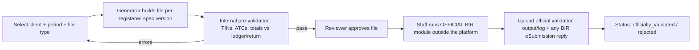

# 03 — Client-to-Accountant Workflows

Each workflow lists its actors, steps, system states and controls. Status names are proposed and will become database enums.

---

## W1. Client onboarding

**Actors:** firm_manager, accountant, client_owner

**Controls**
- The taxpayer profile stays in `draft` until a reviewer approves it. Compliance calendars are generated only from approved profiles.
- The TIN format is checked: 9 digits plus a branch code. The format is to be confirmed (doc 08 item R-03).
- Opening balances are posted as one balanced journal entry of type `opening`, linked to supporting documents.
- The engagement letter, consent and privacy notice are recorded with timestamps (RA 10173; text needs legal review).

---

## W2. Monthly document submission

**Actors:** client_user, client_owner, bookkeeper

**Controls**
- Files go to the private bucket under `clients/{client_id}/...`. Allowed MIME types are on an allowlist, and size is capped (proposed: 25 MB).
- A SHA-256 hash is computed on upload, and duplicate hashes within the same client are flagged.
- A document linked to a posted entry cannot be deleted.
- Each document carries a category (sales invoice, purchase invoice, 2307 received, bank statement, payroll, other), a period and an optional counterparty.

---

## W3. Information request (Request for Information, RFI)

1. A staff member creates a request with a due date, linked to a client, a period and optionally an entry or document.
2. The client is notified by email and in the portal.
3. The client answers in text, by upload, or both.
4. Staff resolve or reopen the request.

States: `open → answered → resolved` or `open → cancelled`. Overdue requests show on the dashboard.

---

## W4. Bookkeeping, review and posting

See doc 05 for the full journal entry lifecycle.

---

## W5. Period close

1. The preparer finishes the checklist: all documents processed, no open requests that block close, bank reconciled (when that module exists), and the trial balance reviewed.
2. A reviewer **soft-closes** the period. Only adjusting entries approved by a reviewer can then be posted.
3. A manager **locks** the period. No posting at all is allowed after that.
4. Reopening needs a manager, a reason and an audit event, and alerts the assigned reviewer.

---

## W6. Tax return preparation and filing

**Controls**
- A return records the rule-set version, the form code, the **form version** (for example `2550Q April 2024 (ENCS)`) and the source ledger snapshot it used, which is a hash of the underlying journal lines.
- If the ledger changes after a return is `reviewed`, the return is flagged `stale`.
- **The platform does not submit returns to the BIR.** Staff file through eFPS, the eBIRForms offline package or another BIR-sanctioned channel, then upload the confirmation. A manual step in the client's chosen filing channel is required. Whether the Firm uses the eBIRForms offline package or eFPS for each client is per-client data.
- Whether a client must approve each return before filing (proposed) or approval can be waived is decision D-07.

---

## W7. DAT file generation and validation (QAP, SAWT, SLSP, alphalists)

- Internal pre-validation is labelled **"Pre-check (not BIR validation)"** everywhere in the UI.
- If the official BIR validation module is a Windows desktop application, as historically, it runs outside the platform. Whether staff run it on a Firm workstation is part of decision D-05.

---

## W8. Withholding certificates (2307 / 2316)

- 2307 data issued by a client comes from purchase or disbursement transactions that carry an ATC. The printable format must match the current official form version, which is **OPEN** (doc 08).
- 2307s a client receives are uploaded in W2 and recorded as creditable tax withheld. They feed the SAWT.

---

## W9. Correction workflows

| Situation | Mechanism |
|---|---|
| Error in a posted entry, period still open | Reversal entry plus a corrected entry, linked as `reverses` / `corrects` |
| Error found after the period is locked | An adjusting entry in the current open period, or a manager reopens the period (SoD-4). Accountant policy is decision D-08. |
| Error in a filed return | An amended return version, linked to the original. The original stays immutable. |
| Wrong document upload | Soft-delete only if the document is unlinked. Otherwise unlink it through a reversal first. |
