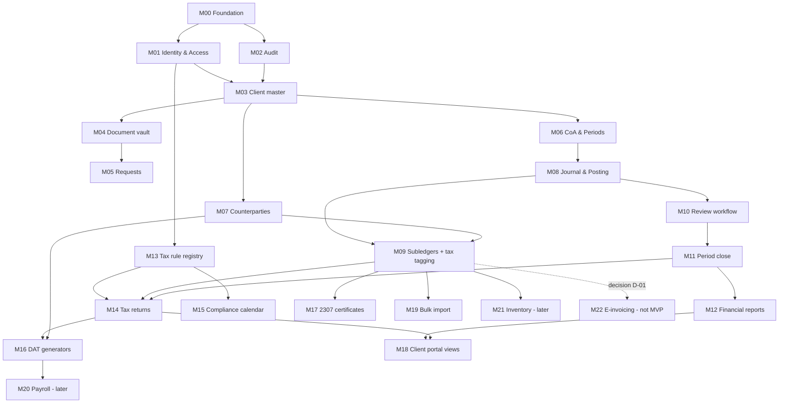

# 04 — Module Dependency Map

## 1. Modules

| ID | Module | Depends on | Notes |
|---|---|---|---|
| M00 | Platform foundation: repo, CI, migrations, environments, logging | — | Phase 2 |
| M01 | Identity and access: Supabase Auth, MFA, profiles, firm and client memberships, assignments | M00 | Phase 2 |
| M02 | Audit log: append-only, trigger-based | M00 | Phase 2; every later module writes to it |
| M03 | Client master and taxpayer profile: effective-dated registrations, branches | M01, M02 | |
| M04 | Document vault: private storage, RLS on storage objects, hashing, categories | M01, M02, M03 | |
| M05 | Requests (RFI) and notifications: email and in-app | M01, M03, M04 | |
| M06 | Chart of accounts and fiscal periods | M03 | |
| M07 | Counterparty registry: TIN, registered name, address | M03 | Prerequisite for withholding, SLSP and alphalists |
| M08 | Journal and posting engine: drafts, posting functions, reversals, idempotency | M06, M02 | The accounting core |
| M09 | Subledgers: sales, purchases, cash receipts, cash disbursements; tax tagging (VAT class, ATC) | M08, M07, M04 | |
| M10 | Review and approval workflow (generic) | M01, M08 | Reused by M14, M15 and M16 |
| M11 | Period close | M08, M10 | |
| M12 | Financial reporting: trial balance, general ledger, balance sheet, income statement, books printouts | M08, M11 | |
| M13 | Tax rule registry: versioned rule sets, ATC tables, form versions, source links, sign-off | M01, M02 | **Can be built in parallel with M06–M12** |
| M14 | Tax computation and return working papers | M09, M11, M13, M10 | Each form is a separate deliverable that needs accountant golden tests |
| M15 | Compliance calendar and deadline tracking | M03, M13 | |
| M16 | DAT / alphalist generators and the validation results register | M09, M07, M14, M13, M10 | **Blocked until official file structures are obtained (doc 09)** |
| M17 | Withholding certificate generation (2307 data and printouts) | M09, M07, M13 | The form layout is OPEN |
| M18 | Client portal views: dashboards, approvals | M04, M05, M12, M14 | |
| M19 | Bulk import (CSV/Excel staging) | M09 | |
| M20 | Payroll (compensation withholding, 2316, 1604-C alphalist) | M08, M13, M16 | Optional; later phase |
| M21 | Inventory | M09 | Optional; later phase |
| M22 | E-invoicing (issuing client invoices) | M09, M13 | **Not recommended for the MVP**; decision D-01 |
| M23 | Production deployment, backup and restore, monitoring | all | Final hardening |

## 2. Dependency graph

## 3. Critical path

M00 → M01 → M03 → M06 → M08 → M09 → M11 → M14 → M16

**External blockers on the critical path:**
1. Accountant golden test cases for each return in scope (blocks M14).
2. Official BIR DAT file structures, from the RMC 15-2025 annexes or later, and the RELIEF/SLSP specification (blocks M16).
3. Signed-off rule sets (blocks M14 and M15 going live).
