# 05 — Accounting Transaction Lifecycle

## 1. Journal entry states

```mermaid
stateDiagram-v2
  [*] --> draft
  draft --> draft: edit (preparer)
  draft --> submitted: fn_submit_entry()
  submitted --> draft: reviewer returns with comment
  submitted --> posted: fn_approve_and_post() (different user)
  draft --> void: preparer discards (never posted; kept for audit)
  posted --> reversed: fn_reverse_entry() creates mirror entry (posted)
  reversed --> [*]
  posted --> [*]
```



| State | Editable? | Affects balances? | Who moves it |
|---|---|---|---|
| `draft` | Yes, by the preparer and the assigned team | No | Preparer |
| `submitted` | No; it must be returned to draft first | No | Preparer submits; reviewer acts |
| `posted` | **Never** | Yes | Reviewer or manager only, through a function |
| `reversed` | Never | Yes, and the reversal entry nets it to zero | Reviewer or manager |
| `void` | Never | No | Preparer (drafts only) |

## 2. Invariants (enforced in the database, not only in the app)

| # | Invariant | Mechanism |
|---|---|---|
| I-1 | A posted entry balances: Σ debit = Σ credit, and the total is > 0 | Checked inside `fn_approve_and_post()`, **plus** a deferred constraint trigger on `journal_lines` that re-checks any entry whose status is `posted` |
| I-2 | Each line is either a debit or a credit, never both, and never negative | `CHECK ((debit > 0 AND credit = 0) OR (credit > 0 AND debit = 0))` |
| I-3 | Posted entries and their lines are immutable | `BEFORE UPDATE/DELETE` triggers raise unless the operation is the controlled status change `posted → reversed` performed by the reversal function |
| I-4 | No posting into a locked period, and only adjustments into a soft-closed period | Period check inside the posting function, plus a trigger |
| I-5 | Posting is idempotent | `UNIQUE (client_id, idempotency_key)` on `journal_entries`; the server generates the key per user action |
| I-6 | Entry numbers are sequential with no gaps, per client per fiscal year (*if* the accountant requires it; decision D-10) | A per-client counter row is locked with `SELECT … FOR UPDATE` inside the posting transaction, and the number is assigned only at posting |
| I-7 | Every line belongs to the same client as its entry and account | Composite foreign keys `(client_id, account_id)` → `accounts(client_id, id)` |
| I-8 | Accounts used on a line are active postable leaf accounts | Trigger check |
| I-9 | Maker–checker | `approved_by <> prepared_by` CHECK, re-verified in the function |
| I-10 | A reversal must reference an original entry, and an entry can be reversed only once | `reverses_entry_id UNIQUE` FK |

## 3. Posting transaction (pseudocode)

```
fn_approve_and_post(entry_id):
  BEGIN (SERIALIZABLE or row locks)
    lock journal_entries row FOR UPDATE
    assert caller has reviewer|manager on entry.client_id (from auth.uid())
    assert entry.status = 'submitted'
    assert caller <> entry.prepared_by
    assert period(entry.date) status allows posting for entry.type
    assert sum(debit) = sum(credit) > 0
    assert all accounts active & postable
    next_no := increment client/fiscal-year counter (locked)
    update entry set status='posted', entry_no=next_no, posted_at=now(), approved_by=caller
    insert audit event
  COMMIT
```

## 4. Source documents to entries

- A **business transaction** (sales invoice record, purchase record, cash receipt, disbursement) holds the commercial and tax data: counterparty, invoice number, VAT class, ATC, gross, net, VAT and withholding amounts.
- Posting a business transaction **generates** its journal entry through account-mapping rules. The two records are linked one-to-one, and posting either posts both.
- Tax reports (SLSP, QAP, SAWT, return working papers) read from the **business transaction tax lines**, and then reconcile against general-ledger control accounts. Any mismatch is flagged.

## 5. Reversal and adjustment

- `fn_reverse_entry(entry_id, reversal_date, reason)` creates a new posted entry with the debits and credits swapped. It links the two, marks the original `reversed`, and requires a reason.
- The reversal date must fall in an open period. When the original's period is locked, the reversal lands in the current period, which is policy decision D-08.
- A reversed business transaction also reverses its tax lines, so tax reports for the original period are **not** silently changed. The accountant must decide how prior-period tax corrections are reported (amended return vs. current period), decision D-08.

## 6. Period states

```
open → soft_closed → locked
          ↑   (manager, reason, audit)   │
          └──────── reopen ──────────────┘
```

## 7. Money and rounding

- `numeric(18,2)` for amounts. Computations that need more precision, such as VAT extraction from a VAT-inclusive amount, use `numeric(20,6)` intermediates and round half-up to 2 dp. **The rounding convention needs accountant confirmation.**
- No floating point anywhere: not in the database, not in TypeScript (a decimal library such as `decimal.js`), and not in JSON transport (amounts are serialized as strings).
