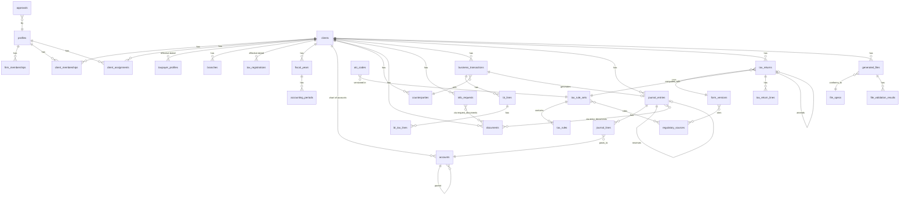

# 06 — Proposed PostgreSQL Entity Relationship Design

> **Design only.** No tables or migrations have been created. All names are proposals for review.

## 1. Conventions

- Primary keys are `uuid` (`gen_random_uuid()`). Human-facing numbers, such as entry numbers, are separate columns.
- Every tenant-scoped table carries `client_id uuid not null`. Composite foreign keys `(client_id, x_id)` stop rows from crossing tenants.
- Every table has `created_at timestamptz default now()` and `created_by uuid`. Mutable tables also have `updated_at` and `updated_by`.
- Money is `numeric(18,2)` with `CHECK (>= 0)` where applicable.
- Effective-dated rows use `valid_from date not null` and `valid_to date null`, with a `daterange` exclusion constraint to prevent overlaps.
- Schemas: `public` (app tables, all under RLS), `audit` (append-only, no direct app access) and `private` (helper functions, not exposed through the API).

## 2. Entity overview

## 3. Tables

### 3.1 Identity and tenancy

| Table | Key columns | Constraints and notes |
|---|---|---|
| `profiles` | `id` (= `auth.users.id`), `full_name`, `email`, `is_active` | One row per auth user, created by a trigger on `auth.users` |
| `firm_memberships` | `user_id`, `role` (`firm_admin`/`firm_manager`/`reviewer`/`accountant`/`bookkeeper`), `is_tax_rule_signatory bool` | `UNIQUE(user_id)` |
| `clients` | `id`, `code`, `display_name`, `status` (`onboarding`/`active`/`archived`) | `UNIQUE(code)` |
| `client_memberships` | `client_id`, `user_id`, `role` (`client_owner`/`client_user`/`client_viewer`/`external_auditor`), `expires_at` | `UNIQUE(client_id,user_id)` |
| `client_assignments` | `client_id`, `user_id`, `assignment_role` (`preparer`/`reviewer`) | Staff-to-client scoping; `UNIQUE(client_id,user_id,assignment_role)` |

### 3.2 Client master

| Table | Key columns | Notes |
|---|---|---|
| `taxpayer_profiles` | `client_id`, `valid_from/to`, `registered_name`, `trade_name`, `tin` (9 digits), `rdo_code`, `taxpayer_type` (`individual`/`corporation`/`partnership`/…), `eopt_classification` (`micro`/`small`/`medium`/`large`), `fiscal_year_end_month`, `status` (`draft`/`approved`), `approved_by` | Effective-dated; no overlapping approved rows |
| `branches` | `client_id`, `branch_code` (e.g. `000`), `address`, `rdo_code` | `UNIQUE(client_id,branch_code)` |
| `tax_registrations` | `client_id`, `branch_id`, `tax_type` (`income`/`vat`/`percentage`/`wt_compensation`/`wt_expanded`/`wt_final`/…), `filing_frequency`, `valid_from/to`, `income_tax_option` (e.g. `graduated_itemized`/`graduated_osd`/`eight_percent`, elected per year) | Mirrors COR 2303; codes come from the rule registry |
| `fiscal_years` | `client_id`, `start_date`, `end_date`, `entry_counter int` | Counter row is locked during posting |
| `accounting_periods` | `client_id`, `fiscal_year_id`, `period_no`, `start_date`, `end_date`, `status` (`open`/`soft_closed`/`locked`) | `UNIQUE(client_id,start_date)` |

### 3.3 Ledger

| Table | Key columns | Notes |
|---|---|---|
| `accounts` | `client_id`, `code`, `name`, `type` (`asset`/`liability`/`equity`/`revenue`/`expense`), `normal_balance`, `parent_id`, `is_postable`, `is_active`, `tax_tag` | `UNIQUE(client_id,code)`; `UNIQUE(client_id,id)` for composite foreign keys |
| `coa_templates`, `coa_template_accounts` | Firm-level templates | Not tenant-scoped; read-only to staff |
| `journal_entries` | `client_id`, `fiscal_year_id`, `entry_no` (null until posted), `entry_date`, `entry_type` (`general`/`opening`/`adjusting`/`closing`/`reversal`/`system`), `status`, `memo`, `idempotency_key`, `prepared_by`, `approved_by`, `posted_at`, `reverses_entry_id`, `business_transaction_id` | `UNIQUE(client_id,idempotency_key)`; `UNIQUE(client_id,fiscal_year_id,entry_no)`; `UNIQUE(reverses_entry_id)`; `CHECK(approved_by IS NULL OR approved_by<>prepared_by)` |
| `journal_lines` | `client_id`, `entry_id`, `line_no`, `account_id`, `debit`, `credit`, `description`, `branch_id`, `counterparty_id` | `CHECK` one-sided non-negative; composite foreign keys; immutable when the entry is posted |
| `entry_documents` | `entry_id`, `document_id` | Links entries to source documents |

### 3.4 Business transactions (tax-relevant subledger)

| Table | Key columns | Notes |
|---|---|---|
| `counterparties` | `client_id`, `tin`, `branch_code`, `registered_name`, `last_name`/`first_name`/`middle_name` (for individuals), `address`, `kind` (`supplier`/`customer`/`both`), `is_vat_registered` | Name fields follow whatever split the DAT specs require (OPEN) |
| `business_transactions` | `client_id`, `kind` (`sale`/`purchase`/`cash_receipt`/`cash_disbursement`/`credit_note`/…), `doc_type`, `doc_number`, `doc_date`, `counterparty_id`, `branch_id`, `status` (mirrors the journal entry), `journal_entry_id` | `UNIQUE(client_id, counterparty_id, kind, doc_type, doc_number)` prevents duplicate invoice encoding (exact key to confirm) |
| `bt_lines` | `transaction_id`, `description`, `amount_net`, `account_id` | |
| `bt_tax_lines` | `bt_line_id`, `tax_kind` (`output_vat`/`input_vat`/`ewt`/`fwt`/`vat_withheld`/`pt`…), `tax_class` (e.g. VAT `vatable`/`zero_rated`/`exempt`/`govt`…, as the rule set defines), `atc_code`, `base_amount`, `rate`, `tax_amount`, `rule_set_id` | The rate is copied for auditability; the rule-set reference shows which rules applied |

### 3.5 Documents and requests

| Table | Key columns | Notes |
|---|---|---|
| `documents` | `client_id`, `storage_path`, `original_filename`, `mime_type`, `size_bytes`, `sha256`, `category`, `period_start`, `status`, `uploaded_by`, `deleted_at` | `storage_path` must start with `clients/{client_id}/`; soft delete only |
| `info_requests` | `client_id`, `title`, `body`, `due_date`, `status`, `related_entry_id` | |
| `info_request_messages` | `request_id`, `author_id`, `body` | |
| `request_documents` | `request_id`, `document_id` | |

### 3.6 Tax rules and regulatory registry

| Table | Key columns | Notes |
|---|---|---|
| `regulatory_sources` | `id`, `issuance_type` (`RR`/`RMC`/`RMO`/`RA`/`form`/`guide`), `number`, `title`, `issued_on`, `url`, `retrieved_on`, `verification_status` (`V-P`/`V-S`/`U`), `notes` | Mirrors doc 08 |
| `tax_rule_sets` | `id`, `code` (e.g. `VAT_PH`), `version`, `valid_from/to`, `status` (`draft`/`pending_signoff`/`active`/`retired`), `authored_by`, `signed_off_by`, `signed_off_at` | `CHECK(signed_off_by <> authored_by)`; only `active` sets are usable in computation |
| `tax_rules` | `rule_set_id`, `key`, `params jsonb` (rates, thresholds, brackets) | JSON schema validated per key |
| `atc_codes` | `rule_set_id`, `atc`, `description`, `rate`, `form_codes text[]`, `payee_type` | Example: WI820/WC820 at ½% (RMC 49-2025) |
| `form_versions` | `form_code` (e.g. `2550Q`), `version_label` (e.g. `April 2024 (ENCS)`), `valid_from`, `source_id` | |
| `rule_source_links` | `rule_set_id`, `source_id` | |

### 3.7 Returns and files

| Table | Key columns | Notes |
|---|---|---|
| `tax_returns` | `client_id`, `branch_id`, `form_version_id`, `period_start`, `period_end`, `status`, `rule_set_ids uuid[]`, `ledger_snapshot_hash`, `amends_return_id`, `prepared_by`, `reviewed_by`, `client_approved_by`, `filed_at`, `filing_reference`, `filing_channel` (`efps`/`ebirforms`/`manual`/`tsp`) | `UNIQUE(client_id, branch_id, form_version_id, period_start, period_end, version_no)` |
| `tax_return_lines` | `return_id`, `item_code`, `amount`, `computed_amount`, `override_reason` | An override needs a reason and is shown to the reviewer |
| `tax_payments` | `return_id`, `paid_at`, `amount`, `channel`, `reference`, `proof_document_id` | |
| `file_specs` | `file_type` (`QAP`/`SAWT`/`SLSP_SALES`/`SLSP_PURCH`/`1604C_ALPHA`/…), `spec_version`, `module_version` (e.g. `Alphalist DEVM 7.4`), `source_id`, `status` | |
| `generated_files` | `client_id`, `file_spec_id`, `period`, `storage_path`, `sha256`, `record_count`, `control_totals jsonb`, `status` (`generated`/`precheck_failed`/`precheck_passed`/`approved`/`officially_validated`/`rejected`/`submitted`) | |
| `file_validation_results` | `generated_file_id`, `kind` (`internal_precheck`/`official_module`/`bir_esubmission_reply`), `result`, `log_document_id`, `recorded_by` | |

### 3.8 Workflow and audit

| Table | Notes |
|---|---|
| `approvals` | Generic: `subject_type`, `subject_id`, `action` (`submit`/`approve`/`return`/`client_approve`), `actor_id`, `comment` |
| `audit.events` | `id bigserial`, `occurred_at`, `actor_id`, `client_id`, `action`, `table_name`, `row_id`, `old jsonb`, `new jsonb`, `ip`, `user_agent`. **INSERT only**: there are no UPDATE or DELETE grants, and a trigger blocks both. Hash-chaining (`prev_hash`) is proposed as tamper evidence. |
| `audit.access_events` | Document downloads and data exports |

## 4. Index highlights

- `journal_lines (client_id, account_id)` and `journal_entries (client_id, entry_date) WHERE status IN ('posted','reversed')`
- `bt_tax_lines (atc_code)` and `business_transactions (client_id, doc_date)`
- `counterparties (client_id, tin, branch_code)`
- Partial indexes for dashboards: `info_requests WHERE status='open'`
