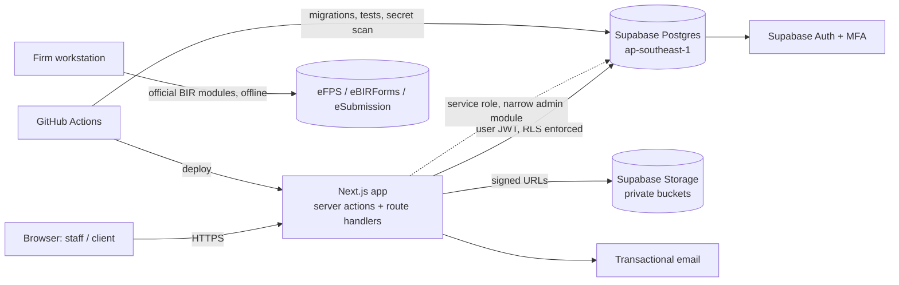

# 11 — Deployment Architecture and Preliminary Cost Estimates

## 1. Environments

| Environment | Purpose | Data | Supabase | App hosting |
|---|---|---|---|---|
| **Local** | Development and automated tests | Synthetic seed only | Supabase CLI local stack (**requires Docker**) | `next dev` |
| **Staging** | Integration, UAT, accountant review of golden cases | Synthetic only | Separate Supabase project | Preview / staging deployment |
| **Production** | Live clients | Real client data | Separate Supabase project (Pro or higher), PITR enabled | Production deployment |

Rules:
- There is no shared database between environments.
- Production keys are never on developer machines.
- Migrations reach staging and production **only through CI** (`supabase db push` with a CI secret), after review.

## 2. Topology

- **Region:** Supabase `ap-southeast-1` (Singapore) is the region closest to the Philippines that is offered. There was no Philippines region to choose at the time of research; this needs re-checking. Cross-border hosting must be cleared under RA 10173 (doc 07 §9; decision D-04).
- **App hosting options:** Vercel (simplest for Next.js) or a container on a cloud provider in Singapore. Decision D-04.
- **Email:** a transactional provider (e.g. Resend, Postmark or SES) for invitations and notifications. No financial data goes in email bodies; emails contain links only.
- **Monitoring:** error tracking with PII scrubbing (e.g. Sentry), uptime checks, and Supabase log drains on paid tiers.

## 2a. Owner direction (2026-10-10): app hosting on Cloudflare — DEFERRED (D-04)

The owner will set up hosting on Cloudflare later. These are planning notes only; nothing has been configured or tested.

- **Next.js on Cloudflare:** the usual path is Cloudflare Workers with the OpenNext Cloudflare adapter. Features that need Node-specific APIs must be checked against the Workers runtime when Phase 2 scaffolds the app. **Not verified for this project.**
- **Secrets:** server-only keys, such as the Supabase service role, go into Cloudflare Workers secrets and are never placed in `NEXT_PUBLIC_*` variables or in wrangler config committed to Git. The rules in doc 07 §2 apply unchanged.
- **Database, Auth and Storage stay on Supabase** under the approved technology direction. The Supabase region and the RA 10173 clearance are still open within D-04.
- **Backups:** Cloudflare R2 is a candidate target for the off-platform logical dumps in §3, subject to encryption and access controls. To be decided.
- **Costs:** the Vercel line in §4 is replaced by Cloudflare plan costs, which were **not researched in Phase 1**. Re-estimate under D-14.

> **Observed 2026-10-10:** the hosted **dev** project was created in **ap-northeast-2 (Seoul)**, not Singapore. That is fine for synthetic data. The production region is still open under D-04 and needs RA 10173 review.

## 3. Backup, restore and recovery (design; to be rehearsed in a later phase)

| Mechanism | Target |
|---|---|
| Supabase daily backups (included in paid plans) | Baseline |
| **Point-in-time recovery (PITR)** add-on in production | RPO of minutes |
| Weekly logical dump (`pg_dump` via CI) to separately controlled encrypted storage | Protection against loss of the platform or account |
| Storage objects: periodic copy to separate encrypted storage | Supabase backups do not cover Storage objects (**to verify**) |
| Restore drill: quarterly restore into a scratch project, then run verification queries (trial balances tie, audit hash chain valid) | RTO target to be agreed (proposed: 8 h) |

Restore runbooks will live in `docs/runbooks/` from the deployment phase onward.

## 4. Preliminary monthly cost estimate (USD)

> **Preliminary and unverified.** The Supabase figures come from third-party 2026 pricing summaries, not from supabase.com/pricing; vendor prices change. Confirm all numbers on official pricing pages before budgeting.

| Item | Low (pilot, ≤ 10 clients) | Moderate (≈ 50–100 clients) | Source / notes |
|---|---|---|---|
| Supabase Pro (production organization) | $25 | $25 | Third-party summaries ([makerkit](https://makerkit.dev/blog/saas/supabase-pricing), [toolradar](https://toolradar.com/blog/supabase-pricing-2026)). Includes a compute credit. |
| Production compute add-on | $0–15 (Micro/Small) | $60 (Medium) | Same sources; size from load testing |
| PITR (7-day) | $100 | $100 | Same sources |
| Staging Supabase project | $0–10 | $10–25 | Possibly a second Pro project; note the free tier pauses |
| Storage and egress overage | ~$0 | $5–25 | Depends on document volume |
| App hosting (e.g. Vercel Pro) | ~$20 per seat | ~$20–60 | **Not verified in Phase 1** |
| Transactional email | $0–20 | $20 | Not verified |
| Error monitoring | $0–26 | $26 | Not verified |
| Domain and DNS | ~$1–2 | ~$1–2 | |
| **Total (approx.)** | **~$170–220 / month** | **~$250–360 / month** | Excludes people, the accountant's time, a security assessment and legal |

One-time or other costs to budget:
- An external penetration test or security review before go-live.
- Legal review for the Data Privacy Act and the client terms.
- Possible BIR-related registrations, such as CAS/CBA and PTI, depending on decisions D-01 and D-02.
- Windows workstation(s) to run the official BIR modules.
