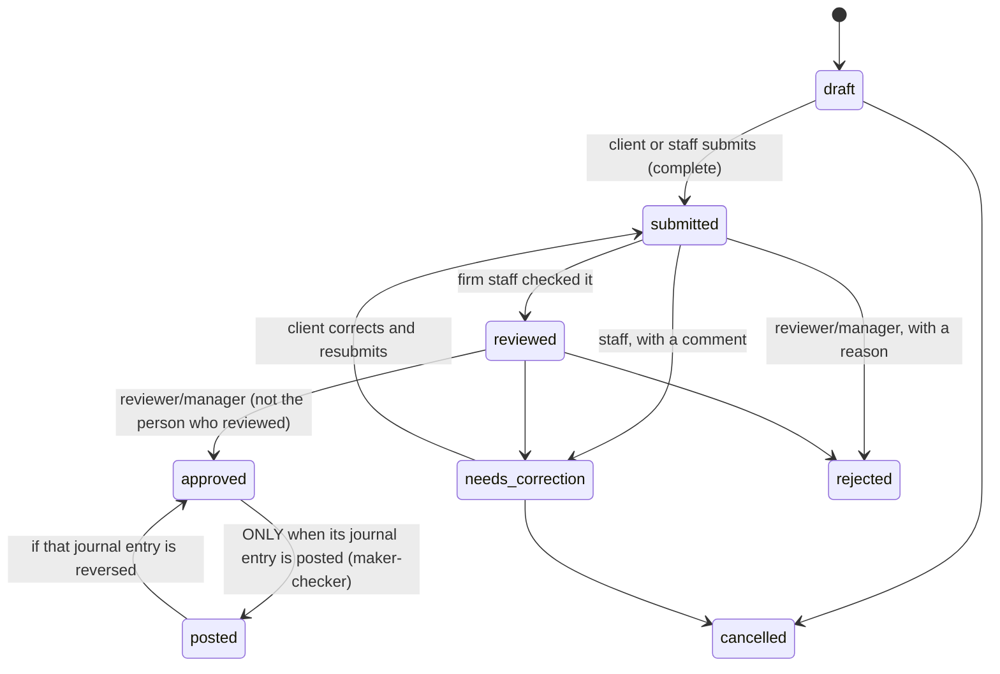

# Canonical Intake Schema (Phase 6)

**Status:** implemented on 2026-10-10 (migrations `20261010160000`–`20261010160500`). This is the shared shape that the later sales, purchase, expense, inventory and payroll modules build on. **Nothing here computes tax.** Amounts such as VAT and withholding are recorded *as printed on the document*.

## 1. Records

| Record | Purpose | Key rules |
|---|---|---|
| `business_profiles` | The client's business profile, versioned. The latest **approved** version is the current one. | One change in progress per client. The person who submits a change cannot approve it. TIN, RDO, ZIP and email are format-checked. VAT status is recorded **as declared**. |
| `counterparties` | Customers and suppliers. | Duplicates are refused: one live record per **TIN**, or per normalized **name** when there is no TIN. |
| `documents` | Metadata for files in the private bucket `client-documents`. | The same file (SHA-256) is stored once per client. Deletion is soft, with a reason, and never allowed while the file is attached to a live transaction. |
| `intake_transactions` + `intake_transaction_lines` | **One generic transaction** for every kind: `sale`, `purchase`, `expense`, `collection`, `payment`, `payroll`, `inventory`, `other`. | See §2. |
| `intake_transaction_documents` | Supporting documents attached to a transaction. | Same client only (composite keys). |
| `import_batches` + `import_rows` | CSV/XLSX import staging. | See §4. |
| `intake_events` | Status history of every record (submission tracking). | Append-only. |
| `intake_comments` | Feedback and replies. `internal` notes are visible to firm staff only. | Append-only. Retry-safe (request key). |

### Transaction fields

| Field | Notes |
|---|---|
| `kind` | One of the 8 kinds above |
| `txn_date` | Not in the future (Philippine date) and not before 2000 |
| `document_type`, `document_ref` | e.g. sales invoice SI-0451 |
| `counterparty_id` **or** `counterparty_name` + `counterparty_tin` | Either a saved customer/supplier, or a name and TIN snapshot as printed on the document |
| `gross_amount` | The total on the document; exact to 2 decimals, never rounded |
| `vat_amount_stated`, `withholding_amount_stated` | As printed on the document; not computed; cannot exceed the total |
| `payment_method`, `description` | |
| `attributes` (JSON object, ≤ 8 KB) | **Extension point** for later modules (e.g. payroll period, inventory item codes). Each module validates its own keys. |
| Lines: `description`, `quantity`, `unit_price`, `amount`, `account_hint` | Optional itemization. Without lines, one line equal to the total is recorded. On submission the line amounts must add up to the total. |
| `source` | `portal` (client), `staff` or `import` |

### Required to SUBMIT (drafts may be incomplete)

| Kind | Required |
|---|---|
| All kinds | date, total amount, at least one line, lines = total |
| sale, purchase, expense, collection, payment | customer/supplier name |
| sale, purchase | invoice/receipt number |
| payroll, inventory, other | description |

The database enforces these rules (`private.assert_txn_complete`). The forms and the importer apply the same rules first (`src/lib/intake/rules.ts`, `mapping.ts`), so users see field-level messages.

## 2. Workflow

- **Customers/suppliers and profiles** go `submitted → approved` directly; there is no `reviewed` step.
- **Who can do what:**

| Action | Who |
|---|---|
| Create, edit, submit, cancel | Client owner, client staff, assigned firm staff. Business profile: client owner or manager/reviewer/accountant. |
| Mark reviewed, request correction | Assigned firm staff |
| Approve or reject | Assigned reviewer or a manager; customers/suppliers: any assigned staff |
| View | All members of the client, including viewers; assigned staff |

- **Content freezes when a record leaves draft/needs-correction.** This is enforced by a trigger, even against direct SQL by the table owner. After that, only the workflow columns change.
- **Nothing is posted automatically.** Staff book an approved transaction by creating a journal entry with `source_type = 'intake_transaction'`. That entry needs the normal maker-checker approval. The existing "one live entry per source" index prevents booking it twice.

## 3. Retry safety (Phase 6 gate)

| Situation | What happens |
|---|---|
| The same request is sent again (double-click, network retry), even 8 times at once | Every create carries a request key that is unique per client. The replay returns the record created the first time. |
| The same receipt is entered again with a new key (e.g. a second browser tab) | Refused as a **duplicate**: same kind + document number + customer/supplier (TIN, else name) while live. Proven with 6 simultaneous attempts: exactly 1 succeeds. |
| Submit or approve is repeated | No-op. Recorded once in the history. |
| The same file is uploaded twice | Refused (SHA-256 per client). Two simultaneous completions: exactly 1 kept. |
| An import is committed twice, or 5 times at once | The batch row lock serializes the commits; a committed batch returns its summary. Each row also carries the key `import:<batch>:<row>`. |

## 4. Imports

1. **Upload.** The file (.csv or .xlsx, ≤ 5 MB, ≤ 5,000 rows) is checked byte by byte and stored privately. The server reads it:
   - **Sheet:** the first one, or the chosen one.
   - **Header row:** detected under title rows, or chosen.
   - **Cells:** cached values only. Formulas are never evaluated, and nothing in a CSV is executed.
2. **Map columns.** Columns are suggested from header names, including the Firm's own (`SI/OR/CI`, `TIN NO.`, `ACCOUNT NAME`, `PARTICULAR`, `CASH`…). The user picks the transaction type and the date format.
3. **Preview.** Every row gets a result:
   - **Ready**
   - **Error**, with messages pointing at the **Excel row number**
   - **Duplicate**: already recorded, or repeats an earlier row in the file
   - **Possible duplicate**: no document number, but the same date, amount and party
4. **Commit.** Ready rows become **submitted** transactions (never posted). Possible duplicates are imported only if the user ticks a box. The summary is stored and shown.

**Value rules:**
- **Amounts:** `₱`/`PHP` signs and thousands separators are accepted. Negative values and more than 2 decimals are refused. Excel floating-point noise in number cells is corrected only within 0.000001 (`64019.999999999993` → `64020.00`).
- **TINs:** found even inside labels (`Non-VAT Reg. TIN: 706-567-954-00001`). A TIN typed as a number that lost its leading zero is refused, with a hint to format the column as Text.

## 5. Documents and storage

- **Private bucket `client-documents`.** The bucket itself enforces a 10 MB limit and the MIME allowlist.
- **Path:** `clients/{client_id}/{yyyy}/{mm}/{document_id}.{ext}`, fixed by the database. No user text appears in it.
- **API users have NO write policy on storage.** The server:
  1. verifies the real bytes (signature must match the extension; executables, HTML/SVG and macro or embedded-object Office files are refused; zip-bomb limits apply);
  2. calls `begin_document_upload` as the user, which checks authority and duplicates and returns the only allowed path;
  3. writes the bytes with the server-only key;
  4. calls `complete_document_upload` as the user, which verifies the stored size.
- **Downloads:** `/api/documents/{id}` checks access under RLS, writes an audit event, and redirects to a **60-second signed URL** that forces a download (`Content-Disposition: attachment`).
- **Not done:** malware scanning (open item R-12).
